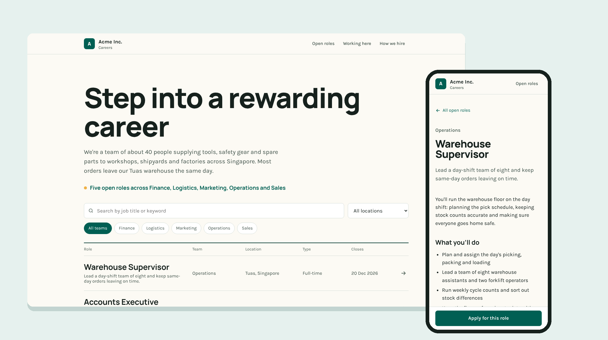

# hr-skills

**Your AI assistant, now doing real HR work.** Skills from the **Everyday AI in HR** YouTube series (@EverydayAIHR) that give the assistant you already use something it can't do on its own: build your company a careers portal you run by chatting, or turn review files into a 9-box talent matrix. Written for Claude, ChatGPT and other assistants.



**[▶ Try the careers portal demo](https://everydayaihr.github.io/hr-skills/skills/careers-portal/portal/)** (an invented company; nothing you type is sent or saved)

## Try it

No setup and no coding. Open your AI assistant and paste:

> Here's a skill: https://raw.githubusercontent.com/EverydayAIHR/hr-skills/main/skills/careers-portal/SKILL.md
> Please read it and help me build a careers page for my company.

The assistant explains what you'll get, asks only what it needs (your company name, logo, careers inbox), builds the portal in your own Lovable account, checks it, and publishes it after you say yes. From then on you just ask: *"Post a job for a warehouse supervisor"*, *"Close the accountant role"*, *"Who applied this week?"*

**Using Claude Code?** Add a skill to your skills folder:

```sh
git clone https://github.com/EverydayAIHR/hr-skills /tmp/hr-skills
cp -r /tmp/hr-skills/skills/careers-portal ~/.claude/skills/
```

## Skills

| | Skill | What your assistant can do with it | Episode |
|---|---|---|---|
| 🧭 | [careers-portal](skills/careers-portal/SKILL.md) | Build a branded careers portal (open roles, job pages, CV upload with consent), check it's safe, then post, edit and close jobs and review applicants from chat | 2, coming soon |
| 🔲 | [nine-box-talent-matrix](skills/nine-box-talent-matrix/SKILL.md) | Place a team on a 9-box grid from annual reviews and a potential assessment, with every placement shown and checkable | [1](episodes/01-nine-box-talent-matrix) |

## The careers portal

### A finished product, not a template

[`skills/careers-portal/portal/`](skills/careers-portal/portal) is a complete careers site: open roles with search and team filters, a page per role, an apply form with drag-and-drop CV upload, clear error messages and consent, a confirmation page and a privacy note. It's built for phones and keyboards, with labelled fields and screen-reader announcements. Your logo and brand colour replace the defaults, and button text stays readable whatever the colour.

### Your data stays yours

The portal is built in **your** Lovable account. CVs go to a private folder there, and applications reach **your** inbox. Nobody else, including this project, can see your portal or your applicants.

### Checked before anyone applies

An assistant can't look at a database and see a leak. So after every build, and before publishing, it runs [`check-portal.sql`](skills/careers-portal/portal/supabase/check-portal.sql), one read-only query, and shows you the result:

```
 check                                          result  detail
 Website visitors cannot read, change or
   delete applications                          PASS    Visitors can only add an application
 Only open, unexpired jobs are public           PASS
 CV bucket exists and is private                PASS    cvs is private
 Visitors cannot open, list or delete CVs       PASS    Visitors can only upload
 Jobs past their closing date still marked open WARN    Delivery Driver
```

(A shortened run on a test database.) Any **FAIL** (a public CV folder, applications readable from the website, drafts showing) is fixed before the portal goes live. The rules in [`schema.sql`](skills/careers-portal/portal/supabase/schema.sql) and the check were tested on PostgreSQL 16, including against deliberately broken setups.

### Run it by chatting

| You say | What happens |
|---|---|
| "Post a job for a delivery driver, closes end of month" | The assistant drafts the ad, shows you the preview, and publishes it only after your yes |
| "Change the designer role to hybrid" | You see the before and after, then confirm |
| "We've filled the accountant role" | The job is closed (kept for your records) and the assistant offers to draft replies to the other applicants |
| "Who applied for the driver role?" | A list with names, dates and secure CV links. Nothing is changed |

### How applications reach you

| Option | Cost | You need |
|---|---|---|
| Your company Gmail, with the CV attached | Free | A shared careers inbox on Gmail or Google Workspace |
| Review in chat, no email | Free | Nothing extra |
| Your own address, like jobs@yourcompany.com | Paid Lovable plan | Your own domain |

Lovable is the default builder. [Replit, Base44 and Bolt](skills/careers-portal/reference/other-builders.md) work too.

## Using a skill with your AI assistant

A skill is a Markdown file (`SKILL.md`) in plain language, so any assistant that reads instructions can follow it.

- **Any assistant (Claude, ChatGPT, …):** paste the skill's raw link with your request, as above, or copy the file's text into the chat or your project instructions.
- **Assistants that support skills (Claude):** add the skill folder to your skills, or install the repo as a plugin.
- **No connectors?** Every skill has a manual route: the assistant gives you text to paste, and you do the clicks.

Results vary between assistants and runs. HR judgement stays with you, because you know your organisation, your people and your local law.

## What's inside

| | |
|---|---|
| `skills/<name>/SKILL.md` | What the assistant follows, including which reference file to read at each step |
| `skills/<name>/reference/` | Guides read only when needed, including `gotchas.md`: what went wrong in testing and how to avoid it |
| `skills/careers-portal/portal/` | The finished portal, its database rules and the self-check |
| `skills/nine-box-talent-matrix/formats/` | Blank review and assessment forms and an interactive 9-box grid |
| `episodes/` | Material from each video |
| `.claude-plugin/` | Lets Claude install the repo as a plugin |

> **All companies, people and figures in the samples are fictional.** Acme Inc., Marendia and everyone at Acme are invented for the series. Nothing here is real employee data or professional advice. Check anything you use against your own policies and local law.

Independent project: not affiliated with, or endorsed by, any AI company or app builder. Product names belong to their owners.

## Licence

MIT. See [LICENSE](LICENSE). The portal loads Manrope and Karla from Google Fonts (SIL Open Font License).
